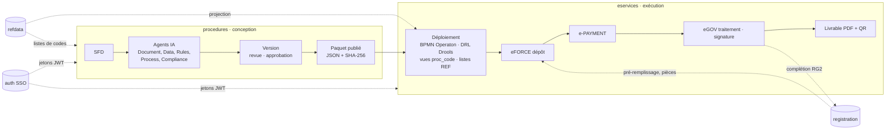

# NEXORA — AI-powered Trade Digital Platform

Plateforme numérique du commerce extérieur, organisée en microservices indépendants (une base de données par
service), alignée sur les standards UN/CEFACT, OMD, ISO et sur le **modèle de référence de la chaîne logistique
internationale** (Buy – Ship – Pay).

| Microservice | Rôle | État | Port (UI de dév.) |
|---|---|---|---|
| [`refdata`](refdata/) | **Référentiel Commun** : tables de référence REF_*, métadonnées ISO 19115, historique, services de requête | ✅ disponible | 8082 (4201) |
| [`auth`](auth/) | **Accès (SSO)** : authentification unique, utilisateurs, groupes, rôles, habilitations, journal de sécurité | ✅ disponible | 8090 (4202) |
| [`registration`](registration/) | **Registre des opérateurs** : enrôlement, NIU, immatriculations, pièces, comptes rattachés (titulaire, CDA) | ✅ disponible | 8083 (4203) |
| [`procedures`](procedures/) | **Studio des procédures** (Single Window AI Studio) : formulaires, pièces, frais, messages et flux, workflow BPMN, règles Drools, agents IA, publication | ✅ disponible | 8084 (4204) |
| [`eservices`](eservices/) | **e-Services** (Runtime du guichet unique) : eFORCE, eGOV, e-PAYMENT, workflow Operaton, dossiers, messages, livrables, supervision | ✅ disponible | 8085 (4205) |
| `data` | Services DATA : entrepôt de données, statistiques, échanges | à venir | 8086 |

## Guichet unique : conception et exécution des procédures

- **Ajouter une procédure** se fait sans code, dans le studio : [docs/ajouter-une-procedure.md](docs/ajouter-une-procedure.md).
- **Cas d'application FIMEX** (SFD e-GUCE 3G v1.4, DM FIMEX v1.1) : [docs/fimex.md](docs/fimex.md).

## Mise en route (développement)

1. Bases : `database\creer-bases-guichet-unique.cmd` (crée `nexora_registration`, `nexora_procedures`,
   `nexora_eservices` ; un seul mot de passe `postgres`). Les secrets sont dans le `.env.local` de chaque service.
2. Construire puis lancer, dans cet ordre : `auth`, `refdata`, `registration`, `procedures`, `eservices`
   (`construire.cmd`, puis `lancer.cmd` de chaque dossier).
3. Comptes de test (un par rôle du guichet unique) : `database\creer-comptes-test.cmd` (service auth démarré).

## Conventions communes

- **Stack** : Java 21 · Spring Boot 4 · PostgreSQL 17 · Angular 22 ; chaque microservice produit un jar exécutable
  qui embarque son interface, **multilingue** (français, anglais).
- **Une base par microservice** (`nexora_<service>`), secrets dans `.env.local` (jamais versionné).
- **API REST versionnée** : `/api/v1/...`, erreurs au format RFC 9457 (`application/problem+json`, propriété `erreurs`).
- **Sécurité** : connexion unique via [`auth`](auth/) (JWT RS256, clé publique JWKS) ; chaque API exige
  `Authorization: Bearer` et contrôle les droits de la revendication `permissions` ; les services s'appellent entre eux
  avec le jeton de l'utilisateur.
- **Interfaces responsives** : ordinateur, tablette et mobile ; charte commune issue du Référentiel Commun.
- **Traçabilité** : chaque écriture est attribuée à l'utilisateur du jeton et transmet `X-Nexora-Channel` (UI, API,
  IMPORT, SYNC) et `X-Nexora-Reason` ; journaux d'audit chaînés (empreintes) en ajout seul.
- **Données de référence** : les autres services ne dupliquent pas les listes de codes ; ils interrogent `refdata`
  (`GET /api/v1/lookup/{REF_TABLE}`) ou ses tables physiques `referentiel.ref_*` (les e-Services en gardent une
  projection en lecture par procédure déployée).
