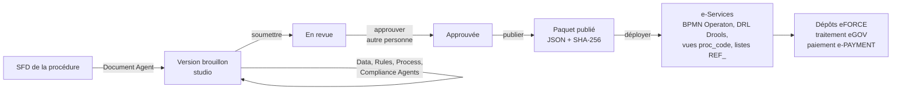

# Ajouter une nouvelle procédure au guichet unique

Une procédure (FIMEX, certificat d'origine, certificat phytosanitaire, autorisation d'importation…) **ne demande
aucune ligne de code**. Elle est modélisée dans le **studio des procédures** (`procedures`, port 8084), publiée sous la
forme d'un **paquet** figé, puis **déployée** dans les **e-Services** (`eservices`, port 8085), qui l'exécutent avec
leur moteur générique : formulaire dynamique, workflow BPMN (Operaton, compatible Camunda 7), règles DRL (Drools),
dossiers, messages JSON / XML / CSV / TXT, paiement, cotation, livrable signé.

FIMEX, livré avec la plateforme (amorcé en brouillon au premier démarrage du studio), sert de référence complète.

---

## 1. Prérequis

| Qui | Rôle (service auth) | Pour quoi |
|---|---|---|
| Concepteur | `CONCEPTEUR_PROCEDURES` | créer et modéliser la procédure, lancer les agents, revoir leurs propositions, soumettre |
| Approbateur | `APPROBATEUR_PROCEDURES` | approuver (il ne peut pas approuver ce qu'il a soumis, RG-GOV-04), publier |
| Administrateur e-Services | `ADMINISTRATEUR_ESERVICES` | déployer la version publiée, paramétrer la cotation |

La procédure se rattache à un **circuit** de la terminologie GUCE (Processus › Phase › Circuit). S'il manque, créez-le
dans **Studio › Terminologie GUCE**.

## 2. Créer la procédure

**Studio › Procédures › Nouvelle procédure**, puis choisir le point de départ :

| Point de départ | Contenu de la version 1 | Quand l'utiliser |
|---|---|---|
| **Gabarit standard** (recommandé) | acteurs (demandeur, administration, agent de traitement, signataire, GUCE, banque, registre), statuts, identification du demandeur pré-remplie depuis le registre (NIU, raison sociale, ville, courriel), lieu de traitement, catalogue de 7 messages (demande JSON, avis de paiement XML, confirmation bancaire XML, complément TXT, décision JSON, livrable JSON, relevé CSV) et 5 flux, livrable, règles DRL de base, workflow BPMN généré | nouvelle procédure de type « demande → paiement → traitement → signature → livrable » |
| **Copie d'une procédure existante** | toute la dernière version (formulaire, pièces, frais, messages, BPMN, DRL, réglages) | procédure voisine (ex. une autre inscription annuelle à partir de FIMEX) |
| **Procédure vide** | rien | modélisation entièrement pilotée par la SFD et les agents |

Renseignez le **code** (majuscules, ex. `CERT_ORIGINE`), le **code CUR** à 3 lettres (le numéro de dossier sera
`PAYS ANNÉE CODE SÉQUENCE`, ex. `CM2026COR000001`), les libellés, le circuit et l'administration responsable.

## 3. Modéliser (onglets de la version)

| Onglet | À faire | Aide des agents |
|---|---|---|
| **Général** | réglages d'exécution (pays, monnaie, fuseau, délai de paiement `P30D`, délai de traitement en heures, champs pivots, en-têtes et mention du livrable), **types de demande** (un code CUR par déclinaison, natures autorisées `INITIAL`, `RENEWAL`, `AMENDMENT`…), **acteurs**, **statuts** | Document Agent : acteurs et délai lus dans la SFD |
| **Formulaire et données** | sections (dont groupes répétitifs, ex. produits), champs : type, longueur, format, obligation, liste (`REF_xxx` du Référentiel Commun, `@LIEUX_TRAITEMENT`, ou valeurs locales `code=FR\|EN`), références UNTDED / OMD / UN/CCL, **chemin BIE SCRDM**, critère de recherche, pré-remplissage depuis le registre, modifiable en amendement | Data Agent : chemin SCRDM D23B de chaque champ et liste du Référentiel Commun ; assistant SCRDM intégré |
| **Pièces et frais** | pièces P1…Pn (obligatoires, ou conditionnelles : `champ == 'valeur'`), frais par bénéficiaire et par type / nature, livrables (code document, validité `FIN_ANNEE` / `UN_AN` / `AUCUNE`, champs imprimés) | Document Agent : tableau « composition du dossier » et « délais et coûts » de la SFD |
| **Messages et flux** | catalogue des messages (type, format **JSON, XML, CSV ou TXT**, élément racine, champs et chemins, champs indexés) ; flux = usage ordonné des messages entre acteurs | — |
| **Workflow BPMN** | ajuster le processus généré dans l'éditeur bpmn-js, ou l'exporter vers **Camunda Modeler**, le modifier, le réimporter | Single Window Agent (Process Design) : génère le BPMN et propose les statuts manquants |
| **Règles DRL** | règles de validation métier (agenda-group `validation`), frais (agenda-group `frais`, généré), banc d'essai Drools | Rules Agent : régénère frais et pièces conditionnelles, signale les règles de gestion sans règle DRL |
| **Agents IA** | joindre la SFD (.docx ou .txt), lancer l'orchestrateur, **revoir chaque proposition** (accepter, corriger, rejeter avec motif) | AI Orchestrator : Document → Data → Rules → Process → Compliance |
| **Contrôles et publication** | lever les erreurs du Compliance Agent, soumettre, faire approuver, publier | Compliance Agent |

Rien n'est appliqué sans revue humaine : les agents sont plafonnés au niveau L2 (proposer) ; soumettre, approuver et
publier sont réservés à l'humain, et une telle demande faite aux agents est refusée et journalisée (AC-AG-01).

## 4. Publier

1. **Soumettre à revue** (concepteur) : refusé tant qu'il reste une erreur de conformité (terminologie, listes de codes,
   chemins BIE, flux sans message, BPMN illisible ou délégué inconnu, DRL qui ne compile pas…).
2. **Approuver** (approbateur, une autre personne) ou **renvoyer en brouillon** avec un commentaire.
3. **Publier** : le paquet JSON est figé, son empreinte SHA-256 enregistrée ; la version précédente devient « remplacée ».

## 5. Déployer dans les e-Services

**e-Services › Administration › Procédures** : la version publiée apparaît « non déployée » ; **Déployer** :

- télécharge le paquet et **vérifie son empreinte** ;
- compile les règles DRL ;
- déploie le BPMN dans le moteur **Operaton** ;
- crée les **vues métier** `proc_<code>.*` (demande, une vue par groupe répétitif, avis de paiement, livrable ; noms
  réglables par `viewNames`) ;
- copie les **listes de codes** `REF_*` utilisées par le formulaire depuis le Référentiel Commun (projection en lecture).

La procédure est aussitôt proposée dans **Nouvelle demande** (eFORCE). Si de nouveaux lieux de traitement sont
nécessaires, ajoutez-les dans **Administration › Cotation** et rattachez au moins un agent de traitement et un
signataire à leur unité (sinon le dossier reste en incident de cotation jusqu'à correction, puis « Relancer »).

## 6. Faire évoluer une procédure

**Studio › procédure › Nouvelle version** copie la dernière version en brouillon. Après publication et déploiement,
les **nouveaux** dossiers suivent la nouvelle version ; les dossiers en cours **gardent la leur** (RG-TRX-01).

---

## Annexe — contrat entre le studio et le Runtime

### Délégués du workflow (`camunda:delegateExpression`)

| Délégué | Champs injectés (`camunda:field`) | Effet |
|---|---|---|
| `${regles}` | `point` = `frais` \| `validation` | évalue l'agenda-group DRL ; pour `frais` : variables `paiementRequis`, `montant` et frais du dossier |
| `${paiement}` | `message` (code du catalogue) | émet l'avis de paiement (lignes par bénéficiaire) et le message correspondant |
| `${cotation}` | — | affecte un agent et un signataire de l'unité du lieu de traitement (aléatoire et équitable), puis transmet la demande (1er message `REQUEST`) avec ses pièces |
| `${message}` | `code` | émet le message du catalogue (observation, décision) |
| `${delivrance}` | `livrable`, `messages` (codes séparés par des virgules), `statut` | produit le livrable PDF (code QR, cachet électronique, validité), émet les messages, met à jour le registre des opérateurs si `registryUpdate=true` |
| `${statut}` | `code` | change le statut du dossier (aussi en écouteur d'exécution `start`) |

Tâches humaines : `camunda:assignee` = `${agentTraitement}`, `${signataire}` ou `${demandeur}` ;
`camunda:formKey` = `nexora:traitement`, `nexora:signature` ou `nexora:complement` ; propriété `decisions` (ex.
`COMPLEMENT,VALIDER,REJETER`) ; la décision est posée dans la variable `decision` (ou `decisionSignataire`).
Message BPMN corrélé par le Runtime : `PAIEMENT_CONFIRME` (clé métier = CUR). Variables disponibles : `dossierId`,
`dossierNo`, `procedure`, `typeDemande`, `nature`, `demandeur`, `delaiPaiement`.

### Faits Drools

`Demande` (`typeDemande`, `nature`, `texte(code)`, `entier(code)`, `nombre(code)`, `renseigne(code)`, `aPiece(code)`,
`lignes(groupe)`, `groupe(groupe)`, `mandataire`, `titulaire`, `anneeCourante`), `Antecedent` (dossiers déposés du même
demandeur : `typeDemande`, `nature`, `statut`, `annee`, `titreValide`, `enCours`), global `Resultat`
(`erreur(champ, message)`, `frais(code, beneficiaire, libelle, montant)`, `variable(nom, valeur)`).

### Messages

Chemins : `$.a.b`, `$.liste[*].x` (JSON) ; `Racine/a/b` (XML) ; nom de colonne (CSV, séparateur `;`) ; clé (TXT,
`clé: valeur`). Un champ sans « champ du formulaire » prend sa valeur dans l'enveloppe : `dossierNo`, `observation`,
`decision`, `decidedBy`, `paymentNoticeNumber`, `requestId`, `totalpaymentNoticeAmount`, `paymentNoticeCurrencyCode`,
`documentReferenceNumber`, `documentVersionId`, `signedDatetime`, `expirationDatetime`, `qrCodeText`,
`electronicSealText`, `fileURIIdentifier`… Un message entrant de type `PAYMENT` portant `paymentNoticeNumber` et
`paymentReferenceText` confirme le paiement (`POST /api/v1/messages/inbound?code=…`, en-tête `Idempotency-Key`).

### Réglages lus par le Runtime

`country`, `currency`, `timezone`, `paymentDelay`, `slaHours`, `cotation`, `processingLocationField`,
`applicantField`, `previousField`, `renewalYearField`, `registryUpdate`, `documentHeaderFr`, `documentHeaderEn`,
`documentMention`, `viewNames`, `bieContext` (Data Agent).

### Ce qui demande du développement

- un nouveau type de tâche automatique (délégué) ou d'intégration externe (douane, système portuaire…) ;
- un traitement métier d'un message entrant autre que la confirmation de paiement ;
- une mise en page de livrable au-delà des réglages (en-têtes, mention, champs imprimés) ;
- l'isolation multi-tenant par Row-Level Security (colonnes `tenant_id` présentes, politiques à activer).
