# NEXORA — Dossier d'architecture technique

| | |
|---|---|
| **Périmètre** | Plateforme NEXORA, guichet unique du commerce extérieur : `auth`, `refdata`, `registration`, `procedures` (studio), `eservices` (Runtime) |
| **Version du document** | 1.0 — 12/10/2026 |
| **Sources** | Dossier de conception NEXORA v4.2 et annexes (SCRDM D23B, modèle WFE PostgreSQL 17), SFD FIMEX e-GUCE 3G v1.4, DM FIMEX v1.1 |
| **Documents liés** | [README](../README.md) · [Ajouter une procédure](ajouter-une-procedure.md) · [Cas FIMEX](fimex.md) · README de chaque service |

---

## Sommaire

1. [Principes d'architecture](#1-principes-darchitecture)
2. [Vue d'ensemble](#2-vue-densemble)
3. [Socle technique](#3-socle-technique)
4. [Microservices](#4-microservices)
5. [Sécurité](#5-sécurité)
6. [Modèle de procédure et paquet publié](#6-modèle-de-procédure-et-paquet-publié)
7. [Agents IA du studio](#7-agents-ia-du-studio)
8. [Exécution des procédures (Runtime)](#8-exécution-des-procédures-runtime)
9. [Données](#9-données)
10. [Intégrations entre services](#10-intégrations-entre-services)
11. [Traçabilité et audit](#11-traçabilité-et-audit)
12. [Interfaces utilisateur](#12-interfaces-utilisateur)
13. [Déploiement et exploitation](#13-déploiement-et-exploitation)
14. [Extensibilité : ajout de nouvelles procédures](#14-extensibilité--ajout-de-nouvelles-procédures)
15. [Limites connues et évolutions](#15-limites-connues-et-évolutions)
16. [Annexe A — Index des API](#annexe-a--index-des-api)
17. [Annexe B — Décisions d'architecture](#annexe-b--décisions-darchitecture)

---

## 1. Principes d'architecture

| Principe | Mise en œuvre |
|---|---|
| **Procédure = donnée, pas code** | Une procédure est modélisée dans le studio puis publiée sous forme d'un **paquet JSON immuable** (formulaire, pièces, frais, messages, flux, BPMN, DRL, livrables, réglages). Le Runtime l'exécute avec des composants génériques. |
| **Séparation conception / exécution** | `procedures` (studio) conçoit et publie ; `eservices` (Runtime) déploie et exécute. Le Runtime ne dépend du studio qu'au moment du déploiement. |
| **Une base par microservice** | `nexora_auth`, `nexora_refdata`, `nexora_registration`, `nexora_procedures`, `nexora_eservices` ; aucun accès direct d'un service à la base d'un autre. |
| **Standards** | Workflow BPMN 2.0, règles DRL, chemins sémantiques UN/CEFACT SCRDM D23B (BIE), UNTDED / OMD / UN/CCL, CUR-GUCE, enveloppe des messages inspirée d'ebXML, erreurs RFC 9457, JWT RS256 / JWKS. |
| **Humain dans la boucle** | Les agents IA proposent ; une personne revoit, soumet, et une **autre** personne approuve et publie. |
| **Traçabilité inaltérable** | Historiques par trigger, journaux d'audit en ajout seul chaînés par empreinte SHA-256, versions publiées figées. |
| **Référentiel unique** | Les listes de codes viennent du Référentiel Commun (`refdata`, tables `REF_*`) ; le Runtime n'en garde qu'une projection en lecture. |

---

## 2. Vue d'ensemble

### 2.1 Contexte

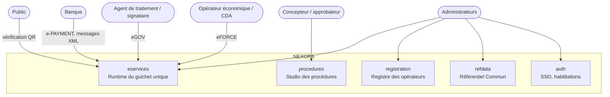

### 2.2 Conteneurs

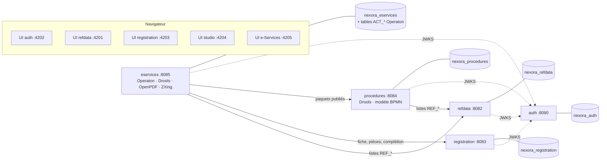

En production, chaque service est un **jar exécutable** qui sert aussi son interface Angular ; les ports 420x ne
servent qu'au développement (`ng serve`).

---

## 3. Socle technique

| Couche | Choix | Version |
|---|---|---|
| Langage, exécution | Java (OpenJDK) | 21 |
| Cadre applicatif | Spring Boot (WebMVC, JDBC `JdbcClient`, Validation, Security, OAuth2 Resource Server, RestClient, Actuator) | 4.1.1 |
| Sérialisation | Jackson 3 (`tools.jackson`) | fourni par Boot 4 |
| Base de données | PostgreSQL (JSONB, GIN, partitionnement, triggers PL/pgSQL) | 17 |
| Migrations | Flyway | fourni par Boot 4 |
| Moteur de workflow | **Operaton** (fork communautaire de Camunda 7, API et attributs `camunda:` compatibles), embarqué | 2.1.5 |
| Moteur de règles | **Drools** (`drools-engine`, `drools-mvel`), DRL compilé à chaud par `KieHelper` | 10.2.0 |
| Livrables | OpenPDF (`org.openpdf.text`), ZXing (QR) | 3.0.5 · 3.5.4 |
| Interfaces | Angular (composants autonomes, signals), bpmn-js + camunda-bpmn-moddle (studio) | 22 · 18.29.1 · 8.0.1 |
| Construction | Maven + `frontend-maven-plugin` (Node embarqué) | Node 24.19 |
| Jetons | JWT RS256 (Nimbus via Spring Security), JWKS | — |

---

## 4. Microservices

Tous les services suivent la même structure :

```
<service>/
  backend/   Spring Boot : src/main/java/com/nexora/<service>/…, db/migration (Flyway), static/ (UI construite)
  frontend/  Angular : core/ (api, auth, i18n, session), pages/, shared/
  database/  scripts de création de la base et du rôle
  construire.cmd · lancer.cmd · .env.local (secrets, non versionné) · README.md
```

Paquets transverses de chaque backend : `security` (filtre JWT, `Habilitations`), `web` (`ApiExceptionHandler`
RFC 9457, `ConfigController`, `WebConfig` CORS + routage SPA, `Json`), `audit` (`Journal`).

### 4.1 `auth` — Accès et SSO (8090)

| Élément | Détail |
|---|---|
| Rôle | Authentification unique, utilisateurs, groupes, rôles, droits, journal de sécurité |
| Paquets | `account` (AccountService, AdminService, Journal), `security` (KeyService, TokenService, SecurityConfig), `web` (SsoController, AdminController) |
| Tables | `auth_user`, `auth_group`, `auth_role`, `auth_permission`, `auth_role_permission`, `auth_user_role`, `auth_user_group`, `auth_group_role`, `auth_session`, `auth_key`, `auth_event` |
| Points clés | Clé RSA générée au premier démarrage et conservée en base (`auth_key`, `kid` publié dans le JWKS) ; jeton valable 8 h, session SSO 10 h (cookie `NEXORA_SSO`) ; liste blanche des URL de retour (`AUTH_REDIRECT_ORIGINS`) ; portail des applications filtré par droits |
| Migration guichet unique | `V2__guichet_unique.sql` : droits `registration.*`, `procedures.*`, `eservices.*`, rôles et groupes du guichet unique (§5.3) |

### 4.2 `refdata` — Référentiel Commun (8082)

Moteur générique de tables de référence : métadonnées (`ref_table`, `ref_column`), entrées JSONB (`ref_entry`),
matérialisées en vraies tables `referentiel.ref_*` synchronisées par trigger ; historique par trigger, pas de
suppression (invalidation). Les autres services l'interrogent par `GET /api/v1/lookup/{REF_TABLE}`. **Non modifié** par
le guichet unique.

### 4.3 `registration` — Registre des opérateurs (8083)

| Élément | Détail |
|---|---|
| Rôle | Enrôlement des opérateurs (NIU), immatriculations, pièces, comptes rattachés (titulaire, mandataire CDA) |
| Schéma | `registre.party`, `registre.party_user`, `registre.party_document`, `registre.party_history` (trigger `party_historique`) |
| Service | `RegistreService` : `ATTRIBUTS` (clés de pré-remplissage exposées par `/attributes`), `mesOperateurs` (opérateurs du jeton), `enroler`, `modifier`, `completer` (ne renseigne **que** les champs vides — RG2 UC-05), pièces, comptes |
| Démonstration | 3 opérateurs, 17 pièces PDF, rattachement de `test.operateur` (titulaire) et `test.cda` (mandataire) |

### 4.4 `procedures` — Studio des procédures (8084)

| Paquet | Classes | Responsabilité |
|---|---|---|
| `studio` | `Modele` (records), `StudioRepository`, `VersionService`, `Gabarit`, `StudioController` | Procédures, versions, parties de version (formulaire, pièces, frais, messages, flux, BPMN, DRL…), cycle de vie, construction du paquet, publication |
| `agents` | `AgentService` (orchestrateur), `Agents`, `RevueService`, `DocumentAgent` + `TexteSource`, `DataAgent`, `ProcessAgent` + `BpmnGenerateur`, `RulesAgent` + `DrlGenerateur`, `ComplianceAgent` + `Conformite`, `ModeleLangage` | Exécutions d'agents, propositions, revue humaine, contrôles de conformité |
| `rdm` | `RdmService`, `RdmController` | Consultation du modèle de référence SCRDM D23B (ABIE / BIE, restrictions contextuelles, types de données et listes de codes) et de la couche Buy-Ship-Pay (§7.5) |
| `regles` | `MoteurRegles`, `Demande`, `Antecedent`, `Resultat` | Compilation et banc d'essai DRL (mêmes classes que le Runtime) |
| `seed` | `AmorcageFimex` | Amorçage de FIMEX en brouillon au premier démarrage (`resources/seed/fimex/version.json`, `fimex.drl`) |

Schémas : `studio` (24 tables, §9.2) et `rdm` (`standard_release`, `abie`, `bie`, index GIN). Le BPMN est lu et contrôlé
avec `operaton-bpmn-model` ; le studio n'embarque **pas** de moteur d'exécution.

### 4.5 `eservices` — Runtime du guichet unique (8085)

| Paquet | Classes | Responsabilité |
|---|---|---|
| `deploiement` | `Paquet`, `DeploiementService`, `VuesMetier`, `ListesService`, `AdministrationController` | Déploiement des paquets publiés, vues métier, projection des listes de codes, administration |
| `dossier` | `Dossier`, `DossierRepository`, `DossierService`, `Validation`, `CurService`, `DossierController` | eFORCE : brouillon pré-rempli, pièces, estimation, dépôt (CUR), visibilité |
| `moteur` | `Delegues` (`statut`, `regles`, `paiement`, `cotation`, `message`, `delivrance`), `TacheService`, `EchangesController` | Délégués BPMN génériques, tâches humaines eGOV, échanges |
| `message` | `Formats`, `MessageService` | Production et lecture des messages JSON / XML / CSV / TXT, idempotence, états |
| `paiement` | `PaiementService` | Avis de paiement, confirmation bancaire, encaissements, relevés |
| `cotation` | `CotationService`, `Demonstration` | Affectation agent / signataire par unité |
| `livrable` | `LivrableService` | PDF, QR, cachet HMAC, vérification publique |
| `registre` | `Services` | Clients REST vers `procedures`, `registration`, `refdata` |
| `audit` | `Journal` | Journal d'audit chaîné |

Schéma `wfe` (moteur de workflow des échanges, §9.3) ; Operaton crée ses tables `ACT_*` dans le schéma `public` de la
même base. Schémas `proc_<code>` créés au déploiement de chaque procédure.

---

## 5. Sécurité

### 5.1 Authentification unique

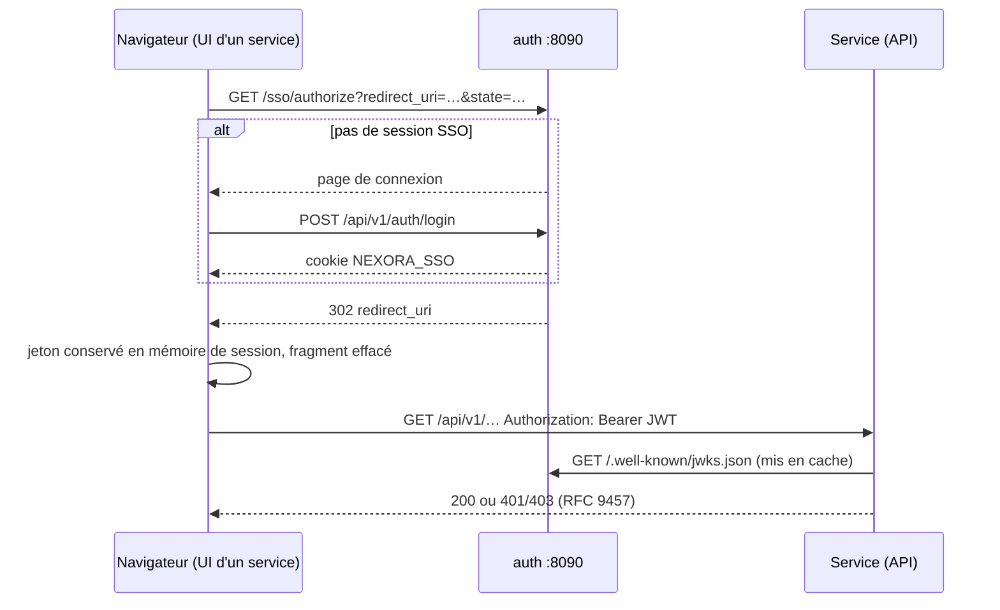

Revendications du jeton : `sub`, `uid`, `name`, `preferred_username`, `email`, `locale`, `roles`, `groups`,
**`permissions`**, `iss`, `iat`, `exp`, `jti` ; en-tête `kid` (RS256).

### 5.2 Autorisation

- Chaque service est un **resource server** stateless : `permissions` → autorités `PERM_<droit>`.
- Contrôle **grossier** dans le filtre (famille d'API), contrôle **fin** dans les services :
  - eFORCE : un opérateur ne voit que les dossiers qu'il a déposés ou ceux de ses NIU (titulaire ou mandataire, via
    `registration /me/parties`) ;
  - eGOV : un agent ne voit et ne traite que les dossiers qui lui sont cotés (RG2 UC-04) ;
  - studio : l'approbateur d'une version ne peut pas en être l'auteur (`approved_by <> submitted_by`, RG-GOV-04).
- Accès publics : `/api/v1/config`, `/api/v1/public/**` (vérification d'un livrable), `/actuator/health|info`.
- Le jeton est accepté en paramètre `access_token` uniquement pour les téléchargements par lien (PDF, pièces).

### 5.3 Droits et rôles du guichet unique

| Rôle | Droits |
|---|---|
| `CONCEPTEUR_PROCEDURES` | `procedures.lire`, `procedures.modeliser`, `refdata.lire` |
| `APPROBATEUR_PROCEDURES` | `procedures.lire`, `procedures.approuver`, `procedures.publier`, `refdata.lire` |
| `OPERATEUR_ECONOMIQUE` | `eservices.deposer` |
| `COMMISSIONNAIRE_AGREE` | `eservices.deposer`, `eservices.mandataire`, `registration.lire` |
| `AGENT_TRAITEMENT` | `eservices.traiter`, `registration.lire` |
| `AGENT_SIGNATAIRE` | `eservices.signer`, `registration.lire`, `registration.completer` |
| `SUPERVISEUR` | `eservices.superviser`, `registration.lire`, `procedures.lire` |
| `BANQUE` | `eservices.encaisser` |
| `ADMINISTRATEUR_ESERVICES` | `eservices.administrer`, `eservices.superviser`, `procedures.lire`, `registration.lire`, `registration.gerer`, `refdata.lire` |
| `ADMINISTRATEUR` | tous les droits |

Droits du registre : `registration.lire`, `registration.gerer`, `registration.completer`.

### 5.4 Autres mesures

| Menace | Mesure |
|---|---|
| Injection SQL | Requêtes paramétrées (`JdbcClient`) ; identifiants dynamiques des vues contrôlés par `^[a-z][a-z0-9_]{0,62}$` |
| XXE | Analyseur XML sans DTD ni entités externes (`FEATURE_SECURE_PROCESSING`) |
| Rejeu de messages | Clé d'idempotence unique par tenant (`Idempotency-Key`) |
| Paquet altéré | Empreinte SHA-256 vérifiée au déploiement |
| Faux livrable | Cachet HMAC-SHA256 (clé `ESERVICES_SEAL_SECRET`) vérifiable par QR |
| Redirection ouverte | Liste blanche des origines SSO |
| Secrets | `.env.local` par service, jamais versionné ; mots de passe de base distincts par service |
| Clickjacking | `auth` refuse l'affichage en iframe |

---

## 6. Modèle de procédure et paquet publié

### 6.1 Contenu d'une version

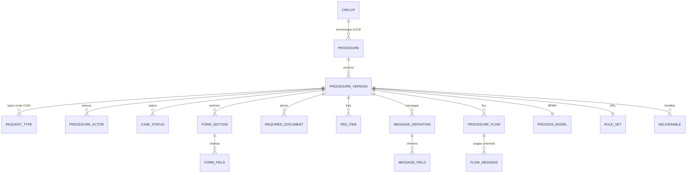

Un **champ** porte : type, longueur, format, obligation (ou condition), liste (`REF_xxx`, `@LIEUX_TRAITEMENT` ou
valeurs locales), références UNTDED / OMD / UN/CCL, **chemin BIE SCRDM**, indicateurs « recherchable »,
« pré-rempli depuis le registre » et « modifiable en amendement ».

### 6.2 Cycle de vie

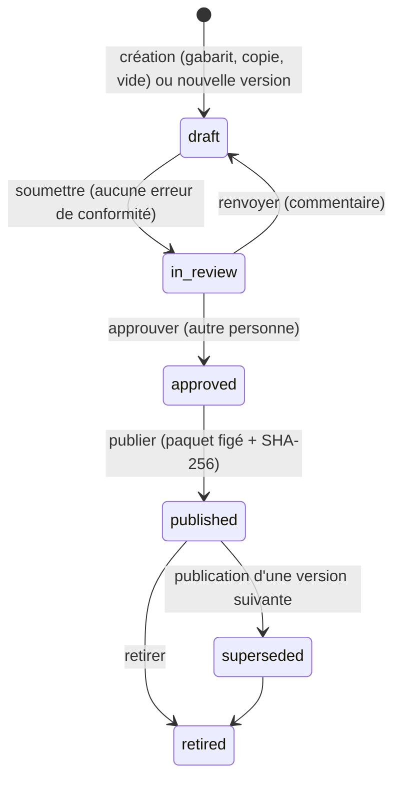

- Trigger `studio.version_immuable` : une version publiée ne peut plus être modifiée (RG-GOV-01).
- Contrainte : les états `published`, `superseded` et `retired` ont un paquet ; les autres n'en ont pas.

### 6.3 Paquet `nexora.procedure/1`

Construit par `VersionService.paquet()` et lu par le record `Paquet` du Runtime :

```
format, procedure{code, labelFr, labelEn, circuitCode, authority, description},
terminology, version, settings{…}, natures[], requestTypes[{code, curCode, natures[]}], actors[], statuses[],
sections[], fields[], documents[], fees[], messages[{code, messageType, contentFormat, rootElement, fields[{path, indexed}]}],
flows[{messages[{seq, messageCode, senderActor, receiverActor}]}], process{processKey, bpmnXml},
rules{drl, businessRules[]}, deliverables[]
```

L'empreinte est calculée par PostgreSQL au moment de la publication (`sha256(package::text)`) et exposée par
`GET /api/v1/published/{code}` ; le Runtime la recalcule et refuse un paquet dont l'empreinte diffère.

### 6.4 Points de départ d'une nouvelle procédure

| Modèle | Implémentation |
|---|---|
| `GABARIT` (défaut) | `Gabarit.java` : acteurs, statuts, identification du demandeur pré-remplie, lieu de traitement, 7 messages (JSON, XML, TXT, CSV), 5 flux, livrable, DRL de base, BPMN généré. Codes des messages préfixés par le code de la procédure (tronqué à 20 caractères) |
| code existant | copie intégrale de la dernière version, clé de processus BPMN renommée |
| `VIDE` | aucune partie |

### 6.5 Sous-sections, gabarit d'IHM et approbation des règles

| Élément | Mise en œuvre |
|---|---|
| **Sous-sections** | `form_section.parent_code` (V5) : une section rattachée à une section de premier niveau ; un seul niveau (un parent qui est lui-même une sous-section est ignoré à l'enregistrement, signalé par le Compliance Agent). Le Runtime affiche la sous-section à l'intérieur de sa section parente |
| **Gabarit d'IHM** | réglage `ihm` de la version : `disposition` (`CONTINU`, `ONGLETS`, `ETAPES`), `colonnes` (1 – 4), `densite` (`COMPACTE`, `NORMALE`, `AEREE`), `libelles` (`DESSUS`, `COTE`), `navigation`, `resume` (suivi à droite ou sous le formulaire), `repliables`. Modèles prédéfinis, import / export JSON (`nexora.ihm/1`) dans l'onglet Formulaire ; transmis au formulaire e-Services par `/catalog/{code}/form` |
| **Règles DRL** | onglet « Règles DRL » (après le workflow), puis « Frais » et « Pièces jointes » ; édition, **compilation** seule (`POST /versions/{id}/rules/compile` : erreurs Drools, règles déclarées, empreinte), banc d'essai, **approbation** (`POST /versions/{id}/rules/approve`, droit `procedures.approuver`) |

L'approbation des règles enregistre l'empreinte SHA-256 du DRL (`rule_set.approved_hash`) : toute modification du DRL
la rend caduque sans l'effacer ; revenir au DRL approuvé la rétablit. Le dernier auteur des règles ne peut pas les
approuver (RG-GOV-04) et le DRL doit compiler. Le contrôle **RG-GOV-05** signale des règles non approuvées ou modifiées
depuis leur approbation (alerte, non bloquante). Une nouvelle version reprend une approbation encore valable.

---

## 7. Agents IA du studio

### 7.1 Orchestration

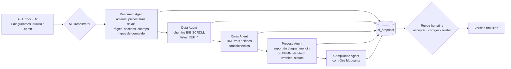

- Chaque exécution est tracée dans `studio.ai_run` (agent, action, décision de politique, statut, résumé) ; chaque
  proposition dans `studio.ai_proposal` (type, charge utile, confiance, statut, revue).
- Types de proposition : `SECTION`, `FIELD`, `REQUEST_TYPE`, `FIELD_MAPPING`, `REFDATA`, `DOCUMENT`, `FEE`, `ACTOR`,
  `STATUS`, `DELIVERABLE`, `BUSINESS_RULE`, `SETTING`, `DRL`, `BPMN` (appliqués à la revue) ; `FINDING`, `REPORT` (informatifs).
- Fichiers joints : `POST /versions/{id}/agents/{code}/run` en multipart accepte plusieurs `file` ; les `.docx`, `.txt`,
  `.md` forment le texte source, les `.drawio`, `.bpmn`, `.xml` les diagrammes (`Agents.Diagramme`).
- Revue en masse possible par type et seuil de confiance (`/proposals/accept-all`).
- **Coupe-circuit** : un agent peut être désactivé à chaud (`PUT /agents/{code}/enabled`, AC-AG-06).

### 7.2 Politique d'autonomie

| Action | Niveau maximal |
|---|---|
| `proposer` | `L2_supervised` (`L3_controlled` pour l'agent de conformité) |
| `appliquer` | `L2_mandatory_review` : revue humaine obligatoire |
| `soumettre`, `approuver`, `publier` | `human_only` : refusé aux agents et journalisé (AC-AG-01) |

### 7.3 Contrôles de conformité (extraits)

Terminologie GUCE renseignée, listes `REF_*` existantes dans le Référentiel Commun (RG-REF-01), chemins BIE valides,
flux sans message, messages sans champ, BPMN illisible ou délégué inconnu, statut référencé mais non déclaré, DRL qui
ne compile pas. Une erreur bloque la soumission.

### 7.4 Données et diagrammes tirés de la SFD

| Composant | Rôle |
|---|---|
| `TexteSource` | lecture du .docx (paragraphes et tableaux) |
| `DonneesSfd` | champs tirés des scénarios des cas d'utilisation (verbes de saisie, énumérations, contraintes « exactement N caractères »), mot de tête → type (numéro, date, année, montant, devise…), code anglais en camelCase ; section `DEMANDE` ou `INSTRUCTION` selon l'acteur principal du cas d'utilisation ; options proposées → types de demande ; socle d'exécution (NIU, raison sociale, lieu de traitement) |
| `DrawioSource` | lecture d'un fichier draw.io, y compris compressé (couloirs, événements, tâches, passerelles, documents, flux, positions) ; XML sécurisé (pas de DTD) |
| `TexteSource` (PDF) | texte des PDF par Apache PDFBox 3 ; figures (word/media) d'une SFD Word extraites pour le modèle de vision |
| `ModeleDonnees` | lecture directe des classeurs `.xlsx` (OOXML, sans dépendance) : entités, attributs, relations 1 — N |
| `Maquette`, `FigmaSource` | écrans, blocs, champs et tableaux des maquettes HTML et des exports Figma JSON |
| `ImportDonnees` | composition du formulaire : écran principal et variantes (→ types de demande), rapprochement libellé ↔ attribut du modèle de données (entités de la procédure préférées), types et listes ; `Referentiel` relie les listes citées aux tables réelles du Référentiel Commun |
| `LectureImages` | images PNG / JPEG lues par le modèle de vision (`nexora.ai.vision-model`), une fois par empreinte : écran → maquette, diagramme → draw.io synthétique → import BPMN |
| `ImportDiagrammes` | choix du diagramme principal (BPMN 2.0 fourni, sinon le draw.io le plus complet), signalement des autres, propositions BPMN, livrables et statuts |
| `BpmnImport` | conversion draw.io → BPMN 2.0 exécutable avec couloirs (collaboration et `laneSet`) et coordonnées d'origine (règles en §8.2 et dans [ajouter-une-procedure.md](ajouter-une-procedure.md#partir-dune-sfd-et-de-ses-diagrammes-ex-domiciliation-bancaire)) |

Validé sur la domiciliation bancaire : SFD v1.1 sans modèle de données et diagrammes BPMN1-3 → 22 champs, 2 types de
demande, workflow du cycle complet (instruction, émission, transferts SWIFT, apurement), 3 livrables, statuts propres ;
dossier exécuté jusqu'aux attestations de domiciliation et d'apurement.

### 7.5 Référentiels UN/CEFACT complémentaires

| Source | Chargement | Usage |
|---|---|---|
| **UNTDED 2005** (ISO 7372) | `rdm.untded_element` (V5), 1 309 éléments chargés au premier démarrage depuis `seed/reference/untded2005.json` (`ChargementUntded`) | le Data Agent déduit la référence `untdedRef` du BBIE SCRDM (même terme de représentation, propriété identique, classe d'objet proche ; ex. *Trade_ Party. Name. Text* → 3036 *Party. Name.Text*) ; le Compliance Agent signale une référence inconnue (**RG-REF-03**) |
| **RSM SCRDM v1.0.0.2**, tables 1 et 2 | `rdm.party_role` (V5) : 17 rôles et lieux (vendeur, acheteur, expéditeur, destinataire, transporteur, transitaire, importateur, exportateur, intermédiaire en douane, facturation, lieux d'enlèvement et de livraison, *Ship From / Ship To*) avec chemin BIE et correspondances « Can Be Mapped To » | un libellé qui désigne un rôle (« Nom de l'expéditeur ») rattache le champ à la partie (`specifiedConsignment/consignor/name`) |
| **RDM Guideline v1.0.0.2**, étape 5 | — | le Data Agent signale les cas 2 (plusieurs correspondances : constat `RDM-GUIDE-2`) et 3 (aucune correspondance : `RDM-GUIDE-3`, extension nationale ou demande d'inclusion à l'UN/CEFACT) |
| **BRS Buy-Ship-Pay v1.0** | — | découpage Buy / Ship / Pay des phases de la terminologie GUCE (`process_phase.bsp_area`) |

#### Complétion du SCRDM D23B et couche Buy-Ship-Pay (V6, V7)

Source normative : la publication SCRDM (`service.unece.org/…/SCRDM/HTML/001.htm`) dans sa forme machine
`github.com/uncefact/spec-JSONschema`, `library/BuyShipPay/D23B` (SCRDMMaster, SCRDMContextCCL, BSPContextCCL,
BasicComponents, codelists). Les migrations sont produites par le générateur `procedures/tools/scrdm` (voir son README), qui reconstruit le modèle
complet, le compare à V2 et vérifie chaque chemin BIE cité (restrictions comprises) ; enrichissement métier tiré des supports de formation
e-GUCE 3G (BSP / ISCRM, Recommandations 1 à 48, MD de l'OMD, EDIFACT, ebXML, NIMP, FAL, ZLECAf, CMR).

| Apport | Tables | Usage |
|---|---|---|
| **27 ABIE complétés** : les ABIE que le SCRDM reprend tels quels de la bibliothèque BSP (`appliedTax`, `recordedStatus`, `referencedProduct`…) étaient vides en V2 ; DEN, définition et 151 BIE ajoutés | `rdm.abie.source` (`SCRDM` / `BSP`), `rdm.bie` | 141 ABIE, 1 249 BBIE, 627 ASBIE ; plus aucun ABIE sans propriété |
| **127 cardinalités corrigées** : V2 ignorait `maxItems: 1` (0..n → 0..1, ex. `consignment/id`) et la liste `required` du CCL (→ 1..x, ex. `advancePayment/paidAmount`) | `rdm.bie` | — |
| **Restrictions contextuelles** : 165 propriétés et 23 composants supplémentaires exclus selon le chemin (ex. sous `logisticsPackage` : `includedTradeLineItem/barcodeId` ; sous la racine : `tradeTransaction/includedTradeLineItem/physicalLogisticsPackage`) | `rdm.context_restriction` | `resoudre` et `cheminsVers` les appliquent : le Data Agent ne propose plus un chemin exclu, le Compliance Agent le refuse (**RG-REF-02**, message « exclu par une restriction contextuelle ») |
| **Types de données et listes de codes** : 86 UDT/QDT utilisés, 129 listes D23B (UNTDID, Rec. 5/19/20/21/23/24/28, ISO 3166/4217, IANA), 13 687 codes ; libellés multiples d'un même code dans `alt_names` (Rec. 23 FCC, Rec. 24 / UNTDID 4405) | `rdm.data_type`, `rdm.code_list`, `rdm.code_list_entry` (V7) | chaque BBIE expose `codeList` / `unitCodeList` ; le Compliance Agent signale les valeurs locales d'un champ liste absentes de la liste fermée du BBIE (**RG-REF-04**, alerte) |
| **Couche BSP** : 4 domaines, 12 processus Acheter-Expédier-Payer, 11 entités de haut niveau (commande, article commercial, expédition, envoi, article en consignation, déclaration, article douanier, mouvement, moyen, équipement, colis) ancrées dans le SCRDM avec leurs données clés, 16 règles de cardinalité et 10 règles de parties | `rdm.bsp_domain`, `bsp_process`, `bsp_entity`, `bsp_entity_relation`, `bsp_entity_party` | lecture métier du modèle et contrôle de cohérence des formulaires |
| **Rôles complétés** : 33 rôles (16 nouveaux : payeur, bénéficiaire, banques, assureur, consignataire de navire, groupeur, agent de transit, courtier, chambre de commerce, douane, ONPV, autorités sanitaire, environnementale, de normalisation, portuaire), groupe d'acteurs (client / fournisseur / intermédiaire / autorité) et code fonction UNTDID 3035 ; importateur et exportateur rattachés à `specifiedConsignment/importer` et `/exporter` | `rdm.party_role` | reconnaissance des rôles par le Data Agent |
| **Messages** : 70 structures BSP-RDM D23B (dont 13 messages maîtres ; SPSCertificate/ePhyto, eCMR, PreferentialCoO, FAL…) et 18 messages UN/EDIFACT (CUSDEC, CUSRES, GOVCBR, APERAK, CONTRL, AUTACK…) | `rdm.exchange_message` | — |
| **Instruments** : 45 Recommandations UN/CEFACT, standards SCRDM / MMT-RDM / CCL, ISO 9735, 15000, 15000-5, 7372, MD de l'OMD et CKR, Convention FAL et formulaires 1 à 7, NIMP 2, 7, 12, 14, 20, 23, 24, 25, 46, CMR, ZLECAf, AFE ; 73 liens vers ce qu'ils normalisent (listes de codes, messages, ABIE, chemins BIE, rôles, entités, processus), dont les liens Recommandation → liste lus dans l'en-tête des listes D23B | `rdm.reference_instrument`, `rdm.instrument_link` | traçabilité normative |

Le BSP Master porte la déclaration en douane (`exchangedDeclaration`) ; le SCRDM l'exclut et la représente par
`specifiedConsignment/applicableCrossBorderRegulatoryProcedure`. Les autorités n'ont pas de rôle dédié dans le SCRDM :
elles sont rattachées au destinataire du message réglementaire (`exchangedDocument/recipient`) avec leur code 3035.

Consultation : page « Dictionnaire de données » du studio (onglets SCRDM D23B, listes de codes, modèle Buy-Ship-Pay,
instruments et messages, UNTDED 2005, rôles des parties) ; API `GET /rdm`, `/rdm/abies/{code}` (avec `restrictions`),
`/rdm/data-types`, `/rdm/code-lists`, `/rdm/code-lists/{id}?q=`, `/rdm/bsp`, `/rdm/instruments`, `/rdm/messages`,
`/rdm/untded?q=`, `/rdm/untded/{tag}`, `/rdm/party-roles`.

### 7.6 Modèle de langage

Les agents peuvent s'appuyer sur un **modèle de langage auto-hébergé** (souveraineté : aucune donnée ne quitte
l'infrastructure choisie). `ModeleLangage` est un client de l'API compatible OpenAI `POST /v1/chat/completions`
(Ollama, vLLM, LM Studio, llama.cpp, TGI), en `java.net.http`, température 0, réponse JSON (`response_format`
`json_object`, abandonné automatiquement si le serveur le refuse).

| Réglage (`.env.local`) | Rôle | Défaut |
|---|---|---|
| `NEXORA_AI_URL` | base de l'API, ex. `http://localhost:11434/v1` (Ollama) | vide → pas de modèle |
| `NEXORA_AI_MODEL` | nom du modèle sur le serveur, ex. `qwen2.5:7b` | vide → pas de modèle |
| `NEXORA_AI_API_KEY` | jeton `Bearer` si le serveur en exige un | vide |
| `NEXORA_AI_TIMEOUT` | délai maximal d'un appel (ISO 8601) | `PT300S` |
| `NEXORA_AI_MAX_CHARS` | taille des morceaux de SFD envoyés au modèle | 20 000 |

| Agent | Rôle du modèle | Validation par le code |
|---|---|---|
| Orchestrator | choisit les agents utiles d'après l'objectif | codes restreints à la séquence connue, ordre imposé, conformité toujours incluse ; le refus de soumettre / approuver / publier reste une règle déterministe |
| Document Agent | extrait de la SFD (par morceaux) acteurs, pièces, frais, délais, règles de gestion, chacun avec une citation | la citation doit figurer dans le document (à la ponctuation et aux accents près), le montant ou le délai dans la citation ; doublons et éléments existants ignorés ; sinon l'élément est écarté et compté |
| Data Agent | départage les rapprochements SCRDM incertains (score < 0,75 ou deux candidats proches), par lots de 8 champs | choix limité aux 5 candidats heuristiques ; « aucun » écarte la proposition ; toute autre réponse est ignorée |
| Rules, Process, Compliance | — (génération et contrôles déterministes) | — |

Garanties : les propositions du modèle portent une confiance plafonnée (0,6 à 0,85) et la mention du modèle dans leur
justification ; elles suivent la même revue humaine que les autres. Le document et l'objectif sont transmis comme
données délimitées, jamais comme consignes. Si le serveur est absent ou répond mal, l'agent continue en heuristique et
le signale (« modèle injoignable »). Chaque exécution (`studio.ai_run`) enregistre le modèle, le nombre d'appels et
d'échecs, la durée cumulée et l'**empreinte SHA-256 des réponses** (`llm_calls`, `llm_failures`, `llm_millis`,
`output_hash`, migration `V3__modele_heberge.sql`). L'état du serveur (joignable, modèle installé) est exposé par
`GET /api/v1/agents`.

Dimensionnement indicatif : un modèle de 7–8 milliards de paramètres quantifié (≈ 5 Go) tourne sur processeur avec
16–32 Go de RAM, lentement (plusieurs minutes pour une SFD) ; un GPU de 8 Go ou plus le rend interactif ; vLLM sur GPU
est recommandé en production.

---

## 8. Exécution des procédures (Runtime)

### 8.1 Déploiement

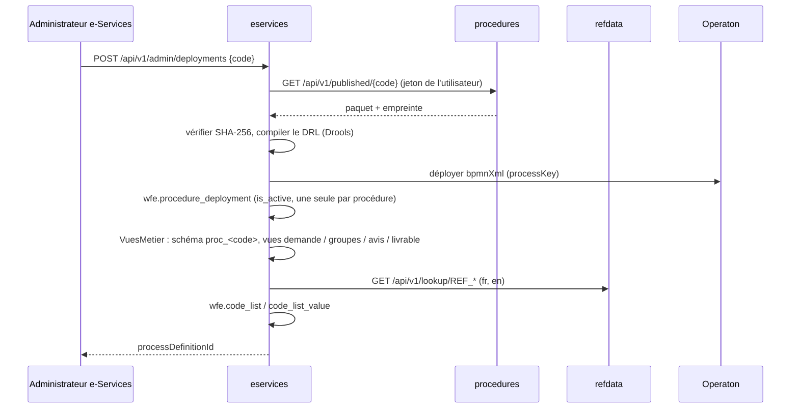

Les nouveaux dossiers suivent la version active ; un dossier en cours garde la version et la définition de processus
de son dépôt (RG-TRX-01). Le paquet d'un déploiement est mis en cache (immuable).

### 8.2 Workflow générique (gabarit)

```mermaid
flowchart LR
  S((Dépôt)) --> F["${regles} point=frais"]
  F --> G1{Paiement requis ?}
  G1 -->|oui| PA["${paiement}<br/>avis + message XML"]
  PA --> EB{{Événement}}
  EB -->|message PAIEMENT_CONFIRME| J((·))
  EB -->|timer ${delaiPaiement}| X[Annulation]
  G1 -->|non| J
  J --> V["${regles} point=validation"]
  V --> C["${cotation}<br/>agent + signataire,<br/>transmission eGOV"]
  C --> T[/Traitement<br/>${agentTraitement}/]
  T --> G2{Décision}
  G2 -->|COMPLEMENT| CO[/Complément<br/>${demandeur}/] --> T
  G2 -->|REJETER| RJ["${message} décision"] --> E1((Rejeté))
  G2 -->|VALIDER| SG[/Signature<br/>${signataire}/]
  SG --> G3{Décision du signataire}
  G3 -->|VALIDER| DL["${delivrance}<br/>PDF + QR + cachet,<br/>messages, registre"] --> E2((Validé))
  G3 -->|REJETER / renvoi| T
```

- Les **statuts** du dossier sont posés par `${statut}` (tâche ou écouteur `start`).
- Un workflow **importé d'un diagramme** suit le même contrat (cotation avant la première tâche de l'organisme
  instructeur, délégués `delivrance` et `statut`) ; il peut comporter des décisions propres (`OUI,NON`), plusieurs
  livrables et des embranchements parallèles. Les tâches des couloirs partenaires sont des `bpmn:task` franchies sans
  attente (alerte de conformité).
- **Données d'instruction** : section `INSTRUCTION` du formulaire, saisie par l'agent dans sa tâche de traitement
  (`TacheService` → `DossierService.instruire`), exigée pour une décision favorable si la tâche la déclare dans sa
  propriété `fields` ; absente du formulaire du demandeur et non modifiable par lui.
- Délégués Spring en portée `prototype` : les champs `camunda:field` (`Expression`) sont propres à chaque appel.
- Tâches humaines : `camunda:assignee` = `${agentTraitement}`, `${signataire}`, `${demandeur}` ; `camunda:formKey` =
  `nexora:traitement` | `nexora:signature` | `nexora:complement` ; propriété `decisions` ; variable `decision`.
- Variables de processus : `dossierId`, `dossierNo`, `procedure`, `typeDemande`, `nature`, `demandeur`, `delaiPaiement`.
- Exécution asynchrone par le job executor Operaton (3 tentatives) ; les incidents sont listés et relancés depuis
  l'administration (`/admin/incidents`, `/admin/incidents/{job}/retry`).

Le contrat complet des délégués est en annexe de [ajouter-une-procedure.md](ajouter-une-procedure.md#annexe--contrat-entre-le-studio-et-le-runtime).

### 8.3 Règles Drools

- `MoteurRegles` compile le DRL **une fois par empreinte** (cache) ; `verify()` remonte les erreurs au studio.
- Un **agenda-group** par point d'évaluation : `validation`, `frais` ; seul le groupe demandé est déclenché.
- Faits : `Demande` (accès typé aux champs, lignes de groupes, pièces, mandataire/titulaire, année courante),
  `Antecedent` (dossiers antérieurs du demandeur) ; global `Resultat` (`erreur`, `frais`, `variable`).
- Les mêmes classes (`com.nexora.regles`) sont utilisées par le studio (banc d'essai) et par le Runtime.

### 8.4 Dossier

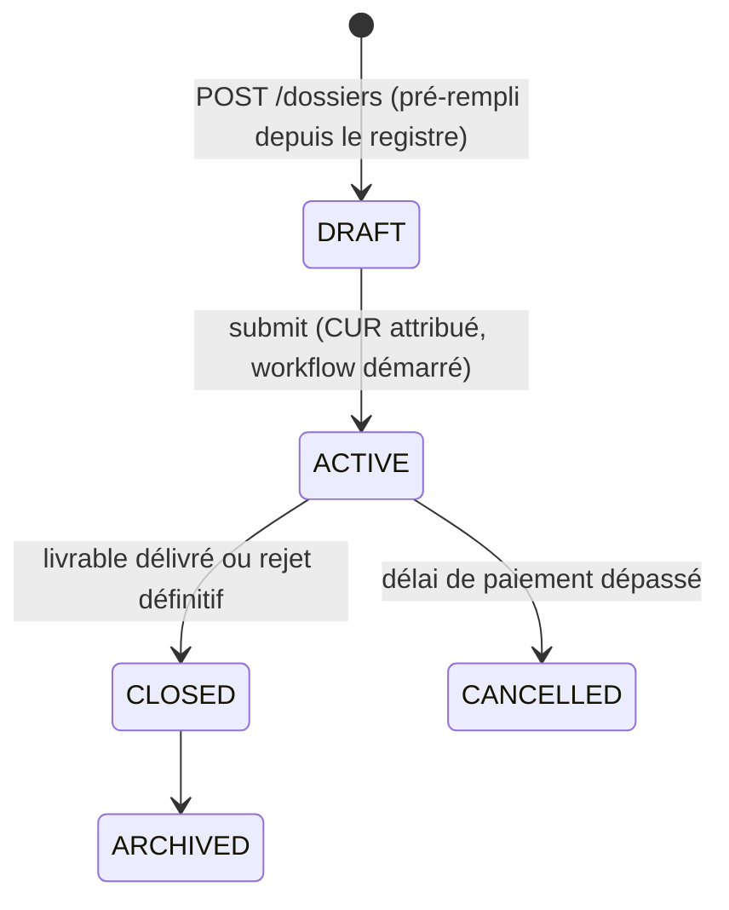

- `lifecycle` (technique) et `status` (terminologie GUCE de la procédure : `EN_ATTENTE_PAIEMENT`,
  `EN_ATTENTE_TRAITEMENT`, `VALIDE`…) sont distincts ; chaque changement de statut est historisé en ajout seul.
- Contrainte : `dossier_no` est nul si et seulement si le dossier est en brouillon.
- Natures : `INITIAL`, `RENEWAL`, `AMENDMENT` ; un renouvellement ou un amendement reprend le dossier source
  (`parent_dossier_no`) et seuls les champs « modifiables en amendement » restent éditables.
- **Critères de recherche** : les champs déclarés recherchables sont projetés dans `dossier_criterion_value`, puis
  agrégés par trigger dans `dossier.search_criteria` (JSONB, index GIN `jsonb_path_ops`, requêtes `@>`).

### 8.5 CUR (Code Unique de Référence)

Format `PAYS(2) ANNÉE(4) CODE(3) SÉQUENCE(6)`, ex. `CM2026IFI000001`. Incrément atomique dans
`wfe.cur_sequence` par (pays, année, code), année calculée dans le fuseau métier, séquence remise à 1 au 1er janvier,
jamais réattribuée. Les livrables sont numérotés à partir du CUR (`…ATT`, puis `…ATT01` pour un amendement).

### 8.6 Cotation

Le lieu de traitement saisi désigne une **unité administrative** ; le dossier est affecté à l'agent de traitement
actif le moins chargé de l'unité (tirage au sort entre ex aequo) et à un signataire de la même unité ; chaque
affectation est historisée (`wfe.cotation_history`). Sans agent disponible, le job passe en incident jusqu'à
correction du paramétrage.

### 8.7 Paiement (e-PAYMENT)

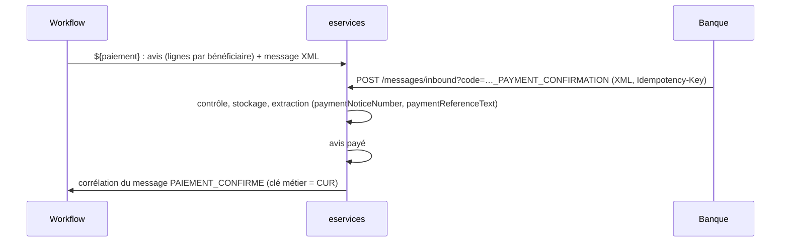

Encaissements par bénéficiaire (MINCOMMERCE, CNCC, GUCE, DGI…) et relevé CSV émis comme message `REPORT` du catalogue.

### 8.8 Messages

| Aspect | Implémentation |
|---|---|
| Formats | JSON (`$.a.b`, `$.l[*].x`), XML (`Racine/a/b`), CSV (colonnes, `;`), TXT (`clé: valeur`) — `Formats` |
| Valeurs | depuis le formulaire (y compris groupes répétitifs) ou l'enveloppe (`dossierNo`, `decision`, `paymentNoticeNumber`, `qrCodeText`…) |
| Enveloppe | message du catalogue, flux et rang, émetteur et destinataire (partenaires `wfe.partner`, qualifiant UNTDID 0007), corrélation, sensibilité, expiration |
| Contenu | séparé dans `wfe.message_content`, **partitionné par mois** (`PARTITION BY RANGE (created_at)`) ; longueur et SHA-256 sur l'en-tête ; jamais recopié dans les journaux |
| Indexation | seuls les champs déclarés indexables sont extraits dans `wfe.payload_value` |
| Validation | résultat (`valid`, `errors`) stocké avec le message |
| Idempotence | `UNIQUE (tenant_id, idempotency_key)` ; un doublon est rejeté sans effet |
| États | machine d'états contrôlée par trigger et historisée |

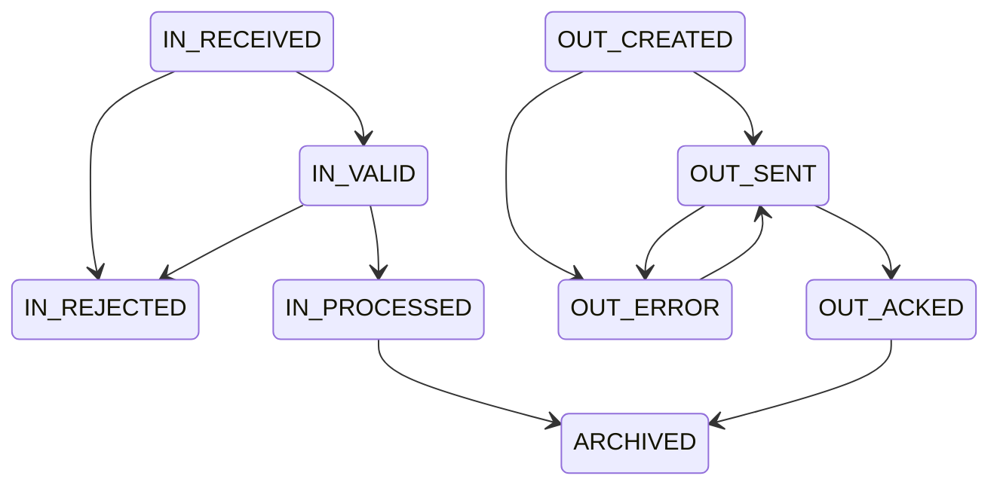

### 8.9 Livrables

`LivrableService` produit un PDF (OpenPDF) avec : en-têtes FR/EN et mention réglables (`documentHeaderFr`,
`documentHeaderEn`, `documentMention`), champs imprimés déclarés dans le livrable, signataire, dates de signature et de
validité (`FIN_ANNEE`, `UN_AN`, `AUCUNE`), **QR code** (ZXing) pointant vers la vérification publique, **cachet
électronique visible** HMAC-SHA256. Aperçu avec filigrane avant signature (rien n'est enregistré). La vérification
publique (`/api/v1/public/verify/{numero}`) contrôle le cachet, le statut et la validité.

> Le cachet prouve l'intégrité et l'origine (clé du service) ; ce n'est pas une signature électronique qualifiée.

---

## 9. Données

### 9.1 Bases et schémas

| Base | Schémas | Contenu |
|---|---|---|
| `nexora_auth` | `public` | comptes, rôles, droits, sessions, clés, événements |
| `nexora_refdata` | `public`, `referentiel`, `referentiel_src` | moteur de référentiel, tables physiques `ref_*` |
| `nexora_registration` | `registre` | opérateurs, comptes rattachés, pièces, historique |
| `nexora_procedures` | `studio`, `rdm` | modélisation, agents, audit ; modèle SCRDM D23B |
| `nexora_eservices` | `wfe`, `public` (ACT_* Operaton), `proc_<code>` | exécution, messages, paiements, livrables, audit ; vues métier |

### 9.2 Schéma `studio`

Terminologie (`trade_process`, `process_phase`, `circuit`, `request_nature`) ; `procedure`, `procedure_version`
(paquet JSONB, empreinte, auteur, approbateur) ; parties de version (`request_type`, `procedure_actor`,
`case_status`, `form_section`, `form_field`, `required_document`, `fee_item`, `message_definition`,
`message_field`, `procedure_flow`, `flow_message`, `process_model`, `rule_set` (avec approbation : `approved_by`,
`approved_at`, `approved_hash`), `deliverable`) ; `form_section.parent_code` (sous-sections) ; schéma `rdm` : SCRDM D23B
(`abie`, `bie`, `context_restriction`, `data_type`, `code_list`, `code_list_entry`), `untded_element`, `party_role`, couche BSP
(`bsp_domain`, `bsp_process`, `bsp_entity`, `bsp_entity_relation`, `bsp_entity_party`), `exchange_message`,
`reference_instrument`, `instrument_link` ; agents
(`agent`, `agent_policy`, `ai_run`, `ai_proposal`) ; `audit_event` (chaîné, lecture seule).

### 9.3 Schéma `wfe`

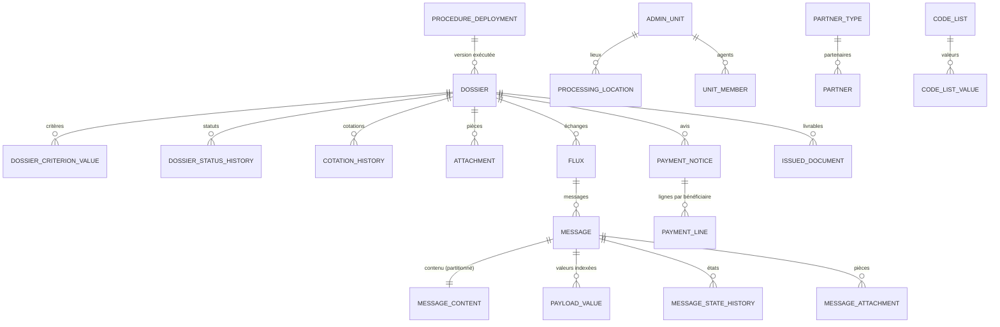

Le formulaire est stocké en JSONB (`dossier.form_data`) ; les colonnes `tenant_id` sont présentes sur les tables
principales en vue d'un cloisonnement multi-pays.

**Correspondance avec le modèle historique TTN_WFE** (MCD PowerAMC, 2004) :

| TTN_WFE | NEXORA `wfe` | Remarque |
|---|---|---|
| `TYPE_DOSSIER` (code, libellé, activité initiale) | `procedure_deployment` | la procédure publiée et sa version remplacent le type de dossier |
| `DOSSIER` (numéro, demande, dates, `ACTIF_CLOS`, `IDENTIFIANT1-3`, `CRITERE1-15`) | `dossier` + `dossier_criterion_value` | les 15 critères et 3 identifiants fixes deviennent des critères en nombre libre (champs `searchable`) ; le formulaire complet est en JSONB |
| `CRITERE_DOSSIER` / `DOSSIER_CRITERE` (nom, valeur) | `dossier_criterion_value` | |
| `FLUX` (numéro, état, actif) / `FLUX_DOSSIER` | `flux` | |
| `MESSAGE` (émetteur, destinataire, type, contenu, message père / initiateur, `ETAPE / SENS / MODULE_ETAT_MESSAGE`) | `message`, `message_content`, `message_state_history`, `payload_value` | contenu partitionné, valeurs indexées par chemin |
| `PARTENAIRE` / `TYPE_PARTENAIRE` | `partner` / `partner_type` | |
| `PIECE_JOINTE` (type de fichier, référence, base image) | `attachment`, `message_attachment` | |

### 9.4 Vues métier `proc_<code>`

Générées au déploiement par `VuesMetier`, pour exposer les données d'une procédure **sous la forme de son modèle de
données métier** (ex. DM FIMEX v1.1) sans tables spécifiques :

| Vue (nom par défaut, réglable par `viewNames`) | Contenu |
|---|---|
| `<code>_request` | une ligne par dossier déposé : colonnes techniques + un champ non répétitif par colonne (snake_case, typée par `wfe.en_nombre`, `wfe.en_date`, `wfe.en_entier`) |
| `<code>_<section>` | une vue par groupe répétitif (`jsonb_array_elements … with ordinality`) |
| `<code>_payment_notice` | avis de paiement |
| `<code>_certificate` | livrables |

Les collisions de noms de colonnes sont évitées (un champ dont la colonne existe déjà n'est pas dupliqué).

### 9.5 Listes de codes

`ListesService` copie, pour chaque procédure déployée, les tables `REF_*` utilisées par le formulaire dans
`wfe.code_list` / `wfe.code_list_value` (FR et EN, entrées valides). Rafraîchissement manuel depuis l'administration
(`POST /admin/code-lists/refresh`). Ex. FIMEX : `REF_COUNTRY` (239), `REF_MEASUREMENT_UNIT` (78), `REF_NACAM` (146).

---

## 10. Intégrations entre services

| Appelant → appelé | Appel | Usage |
|---|---|---|
| tous → `auth` | `GET /.well-known/jwks.json` | vérification des jetons |
| `procedures` → `refdata` | `GET /api/v1/tables`, `/lookup/{table}` | listes proposées et contrôlées par le Data Agent / Compliance |
| `eservices` → `procedures` | `GET /api/v1/published`, `/published/{code}` | catalogue et paquets à déployer |
| `eservices` → `registration` | `GET /me/parties`, `/parties/{niu}`, `/parties/{niu}/documents[/…/content]` | opérateurs de l'utilisateur, pré-remplissage, reprise des pièces d'enrôlement |
| `eservices` → `registration` | `POST /parties/{niu}/complete` | complétion des données manquantes à la délivrance (RG2 UC-05) |
| `eservices` → `refdata` | `GET /api/v1/lookup/{REF}` | projection des listes |
| banque → `eservices` | `POST /api/v1/messages/inbound` | confirmation de paiement |

- Appels synchrones REST (`RestClient`) **avec le jeton de l'utilisateur courant** (propagation d'identité, droits
  vérifiés par l'appelé).
- Dégradation : si le registre est indisponible, la liste des opérateurs est vide et le pré-remplissage ignoré ; le
  dépôt reste possible.
- URL configurables : `AUTH_URL`, `PROCEDURES_URL`, `REGISTRATION_URL`, `REFDATA_URL`.

---

## 11. Traçabilité et audit

| Niveau | Mécanisme |
|---|---|
| En-têtes | `X-Nexora-Channel` (UI, API, IMPORT, SYNC), `X-Nexora-Reason` (motif, encodé URL) |
| Historique d'entité | triggers (`party_history`, `ref_history`, `dossier_status_history`, `message_state_history`) |
| Journal d'audit | `studio.audit_event` et `wfe.audit_event` : ajout seul (trigger refusant UPDATE/DELETE), chaînage `prev_hash` → `row_hash` = SHA-256(prev_hash ‖ date ‖ acteur ‖ action ‖ dossier ‖ motif ‖ détails), sérialisé par verrou consultatif |
| Agents | `ai_run` (y compris refus de politique), `ai_proposal` (revue, commentaire, relecteur) |
| Workflow | historique complet Operaton (`history-level=full`) |
| Sécurité | `auth_event` (connexions, échecs, verrouillages, administration) |

---

## 12. Interfaces utilisateur

- Angular 22, composants autonomes et **signals** ; une application par service, servie par son jar.
- `core/` : `api.ts` (client HTTP typé), `auth.service.ts` + `session.ts` (jeton SSO lu dans le fragment
  `#access_token`, conservé en session, renouvelé par redirection), `i18n.ts` (pipes `t`, `num`, `lib` ;
  dictionnaire `i18n-en.ts`, la clé est le texte français), `titre.ts`.
- Responsive (ordinateur, tablette, mobile), charte commune.

| Application | Écrans |
|---|---|
| Studio (4204) | tableau de bord ; procédures (assistant de création : gabarit, copie, vide) ; procédure ; version (général, formulaire, pièces et frais, messages et flux, workflow **bpmn-js**, règles DRL et banc d'essai, agents, contrôles et publication) ; terminologie ; dictionnaire SCRDM ; agents ; journal |
| e-Services (4205) | accueil ; nouvelle demande ; dossiers ; dossier (formulaire dynamique, pièces, dépôt, paiement, décision, chronologie, messages) ; tâches ; supervision ; encaissements ; messages ; administration (déploiements, cotation, listes, incidents) ; vérification publique |
| Registre (4203) | tableau de bord ; opérateurs ; fiche (données, pièces, comptes, historique) |

Composants génériques : `shared/formulaire.ts` (rendu du formulaire à partir du paquet : types, listes, conditions,
groupes répétitifs, pré-remplissage, champs verrouillés en amendement), `shared/widgets.ts` (`CodePicker`,
`Localisation`, `Statut`), `shared/grille.ts` (éditeur tabulaire du studio).

---

## 13. Déploiement et exploitation

### 13.1 Ports et URL

| Service | API | UI de dév. | Base |
|---|---|---|---|
| auth | 8090 | 4202 | `nexora_auth` |
| refdata | 8082 | 4201 | `nexora_refdata` |
| registration | 8083 | 4203 | `nexora_registration` |
| procedures | 8084 | 4204 | `nexora_procedures` |
| eservices | 8085 | 4205 | `nexora_eservices` |

### 13.2 Construction et lancement

1. Bases : `database\creer-bases-guichet-unique.cmd` (rôles et bases des trois services du guichet unique).
2. Par service : `construire.cmd` (Maven + build Angular copié dans `static/`) puis `lancer.cmd`.
3. Ordre de démarrage : `auth` → `refdata` → `registration` → `procedures` → `eservices`.
4. Comptes de test : `database\creer-comptes-test.cmd` (mot de passe `NEXORA_TEST_PASSWORD` de `auth\.env.local`).

Flyway applique les migrations au démarrage ; Operaton crée/met à jour ses tables (`schema-update=true`).

### 13.3 Configuration (variables d'environnement ou `.env.local`)

| Service | Variables |
|---|---|
| tous | `<SVC>_DB_URL`, `<SVC>_DB_USER`, `<SVC>_DB_PASSWORD`, `<SVC>_PORT`, `<SVC>_CORS`, `AUTH_URL`, `AUTH_JWKS_URI`, `AUTH_ISSUER` |
| auth | `AUTH_ADMIN_PASSWORD`, `AUTH_TOKEN_VALIDITY` (8h), `AUTH_SESSION_VALIDITY` (10h), `AUTH_REDIRECT_ORIGINS`, `AUTH_APPLICATIONS` |
| eservices | `PROCEDURES_URL`, `REGISTRATION_URL`, `REFDATA_URL`, `ESERVICES_PUBLIC_URL`, `ESERVICES_SEAL_SECRET`, `NEXORA_TENANT` (CM), `ESERVICES_DEMO` |

### 13.4 Supervision

- `/actuator/health` et `/actuator/info` sur chaque service.
- Tableau de bord de supervision e-Services : dossiers par statut, tâches, messages, paiements, journal, vues métier.
- Incidents Operaton visibles et relançables depuis l'administration.

### 13.5 Mise à l'échelle (cible)

Les services sont stateless (jeton porteur) et peuvent être répliqués derrière un répartiteur ; le job executor
Operaton fonctionne en cluster sur la base partagée du Runtime. Les partitions mensuelles de `message_content` sont
à créer par une tâche planifiée (aujourd'hui, partition par défaut).

---

## 14. Extensibilité : ajout de nouvelles procédures

| Besoin | Où | Code requis |
|---|---|---|
| Nouvelle procédure de type demande → paiement → traitement → signature → livrable | studio (gabarit ou copie) | **aucun** |
| Nouveaux champs, listes, pièces, frais, statuts, messages, flux | studio | aucun |
| Variante de workflow (étapes, décisions, délais, boucles) avec les délégués existants | éditeur bpmn-js ou Camunda Modeler | aucun |
| Règles de validation ou de frais | DRL dans le studio | aucun |
| Nouvelle liste de codes | `refdata` (table `REF_*`) | aucun |
| Nouvelle vue métier / renommage | réglage `viewNames` | aucun |
| Nouveau type de tâche automatique ou intégration externe (douane, port…) | nouveau délégué dans `eservices.moteur` + contrôle dans `Conformite` | oui |
| Traitement d'un message entrant autre que le paiement | implémentation de `MessageService.Traitement` | oui |
| Mise en page de livrable spécifique | `LivrableService` | oui |

Validation de bout en bout réalisée : une procédure `CERT_ORIGINE_*` créée depuis le gabarit a été publiée,
déployée et exécutée jusqu'au livrable (`CM2026COR000001`) sans modification de code. Procédure détaillée :
[ajouter-une-procedure.md](ajouter-une-procedure.md).

---

## 15. Limites connues et évolutions

| Sujet | État | Évolution proposée |
|---|---|---|
| Multi-tenant | colonnes `tenant_id` présentes, cloisonnement applicatif | activer la Row-Level Security PostgreSQL |
| Modèle de langage | auto-hébergé (API compatible OpenAI) pour l'orchestrateur, le Document Agent et le Data Agent ; appels synchrones dans la transaction de l'exécution | exécution asynchrone des agents (file de tâches) pour les SFD longues ; génération DRL assistée par le modèle avec banc d'essai |
| Signature | cachet HMAC visible | signature électronique qualifiée (PAdES) via une IGC |
| Transport des messages | API REST synchrone | bus de messages / AS4 pour les partenaires externes, accusés `OUT_ACKED` |
| Partitions de messages | partition par défaut | création automatique des partitions mensuelles et archivage |
| Listes de codes | rafraîchissement manuel | abonnement aux changements du Référentiel Commun |
| Résilience des appels | dégradation simple | délais, tentatives et disjoncteur sur les clients REST |
| `refdata` | inchangé | — |

---

## Annexe A — Index des API

Toutes les routes sont préfixées par `/api/v1` sauf mention contraire.

### procedures

| Méthode | Route | Droit |
|---|---|---|
| GET | `/dashboard`, `/procedures`, `/procedures/{code}`, `/versions/{id}`, `/versions/{id}/checks`, `/versions/{id}/journal` | `procedures.lire` |
| POST / PUT | `/procedures`, `/procedures/{code}`, `/procedures/{code}/versions`, `/versions/{id}/parts/{partie}` | `procedures.modeliser` |
| GET | `/versions/{id}/bpmn` (XML), `/versions/{id}/drl`, `/versions/{id}/package` | `procedures.lire` |
| POST | `/versions/{id}/rules/test` | `procedures.modeliser` |
| POST | `/versions/{id}/rules/compile` (DRL soumis ou enregistré) | `procedures.lire` |
| GET · POST | `/versions/{id}/rules/approval` · `/versions/{id}/rules/approve` | lire · `procedures.approuver` (pas le dernier auteur des règles) |
| POST | `/versions/{id}/agents/{code}/run` (JSON ou multipart avec la SFD) | `procedures.modeliser` |
| GET | `/versions/{id}/proposals`, `/versions/{id}/runs`, `/runs`, `/agents` | `procedures.lire` |
| POST | `/proposals/{id}/review`, `/versions/{id}/proposals/accept-all` | `procedures.modeliser` |
| PUT | `/agents/{code}/enabled` | `procedures.approuver` ou `procedures.publier` |
| POST | `/versions/{id}/submit` · `/reject` · `/approve` · `/publish` · `/retire` | modeliser · approuver · approuver · publier · publier |
| GET | `/published`, `/published/{code}` | `procedures.lire` (détenu par `ADMINISTRATEUR_ESERVICES` pour le déploiement) |
| GET / PUT | `/terminology`, `/terminology/circuits` | lire / modeliser |
| GET | `/rdm/abies`, `/rdm/abies/{code}`, `/rdm/search`, `/rdm/resolve`, `/rdm/untded`, `/rdm/untded/{tag}`, `/rdm/party-roles` | `procedures.lire` |
| GET | `/journal` | `procedures.lire` |

### eservices

| Méthode | Route | Usage |
|---|---|---|
| GET | `/catalog`, `/catalog/{code}/form`, `/catalog/{code}/titles`, `/catalog/locations`, `/lookup/{table}` | catalogue et formulaire |
| GET / POST | `/dossiers`, `/dossiers/{id}` | liste (mine, assigned, all), création |
| PUT | `/dossiers/{id}/data` | saisie du brouillon |
| POST / GET / DELETE | `/dossiers/{id}/attachments[/{piece}]` | pièces |
| GET | `/dossiers/{id}/estimate`, `/dossiers/{id}/journal`, `/dossiers/{id}/deliverable/preview` | estimation, chronologie, aperçu |
| POST | `/dossiers/{id}/submit` | dépôt |
| GET / POST | `/payment-notices/{numero}`, `/payment-notices/{numero}/pay` | e-PAYMENT |
| GET / POST | `/tasks`, `/tasks/{id}/complete` | eGOV |
| GET | `/messages/{id}`, `/messages/{id}/content` | messages |
| POST | `/messages/inbound?code=…` (`Idempotency-Key`) | messages entrants (banque) |
| GET | `/documents/{numero}/pdf`, `/public/verify/{numero}` | livrables |
| GET / POST | `/supervision/dashboard`, `/tasks`, `/messages`, `/payments`, `/journal`, `/views`, `/views/{schema}/{vue}`, `/statements` | supervision |
| GET / POST / PUT | `/admin/published`, `/admin/deployments`, `/admin/code-lists[/refresh]`, `/admin/units`, `/admin/locations`, `/admin/members`, `/admin/incidents[/{job}/retry]` | administration |

### registration

`GET /dashboard`, `/attributes`, `/me/parties`, `/parties`, `/parties/{niu}`, `/parties/{niu}/history`,
`/parties/{niu}/users`, `/parties/{niu}/documents[/{id}/content]` ; `POST /parties`, `/parties/{niu}/complete`,
`/parties/{niu}/documents` ; `PUT /parties/{niu}`, `/parties/{niu}/users` ; `DELETE /parties/{niu}/documents/{id}`.

### auth

`/sso/authorize`, `/sso/logout`, `/.well-known/jwks.json`, `/.well-known/openid-configuration` ;
`/api/v1/auth/login|logout|password|me|session|config` ; `/api/v1/admin/users|groups|roles|permissions|events`.

---

## Annexe B — Décisions d'architecture

| # | Décision | Motif | Alternatives écartées |
|---|---|---|---|
| ADR-01 | **Operaton** comme moteur BPMN | Camunda 7 Community est en fin de vie et incompatible Spring Boot 4 ; Operaton en est le fork communautaire, API et extensions `camunda:` identiques (les modèles restent éditables dans Camunda Modeler) | Camunda 8 (Zeebe : infrastructure séparée, licence), Flowable (migration des modèles) |
| ADR-02 | **Drools** embarqué, DRL compilé à chaud | Règles versionnées dans le paquet, banc d'essai identique au Runtime, agenda-groups par point d'évaluation | DMN seul (moins expressif pour les antécédents et les groupes répétitifs) |
| ADR-03 | **Paquet JSON immuable + SHA-256** | Découplage studio / Runtime, reproductibilité, preuve d'intégrité, dossiers en cours sur leur version | lecture directe de la base du studio |
| ADR-04 | **Stockage générique + vues métier** | Aucune migration de schéma par procédure ; modèle métier (DM FIMEX) exposé par vues | tables physiques par procédure (DDL à chaque version) |
| ADR-05 | **Contenu des messages séparé et partitionné** | Tables chaudes légères, purge par partition, journaux sans contenu | contenu dans la table `message` |
| ADR-06 | **Agents plafonnés à la proposition** | Responsabilité humaine sur la réglementation, auditabilité | application automatique des propositions |
| ADR-07 | **Propagation du jeton utilisateur** entre services | Droits vérifiés par chaque service, traçabilité de l'auteur réel | compte technique partagé |
| ADR-08 | **JdbcClient + SQL explicite** | Maîtrise des requêtes JSONB / GIN / partitions PostgreSQL 17 | JPA/Hibernate |
| ADR-09 | **Modèle de langage auto-hébergé, API compatible OpenAI**, validé par le code | Souveraineté des données ; indépendance vis-à-vis du serveur (Ollama, vLLM…) et du modèle ; les sorties du modèle sont vérifiées (citations, candidats) et restent des propositions | API d'un fournisseur en nuage ; SDK propre à un serveur |
